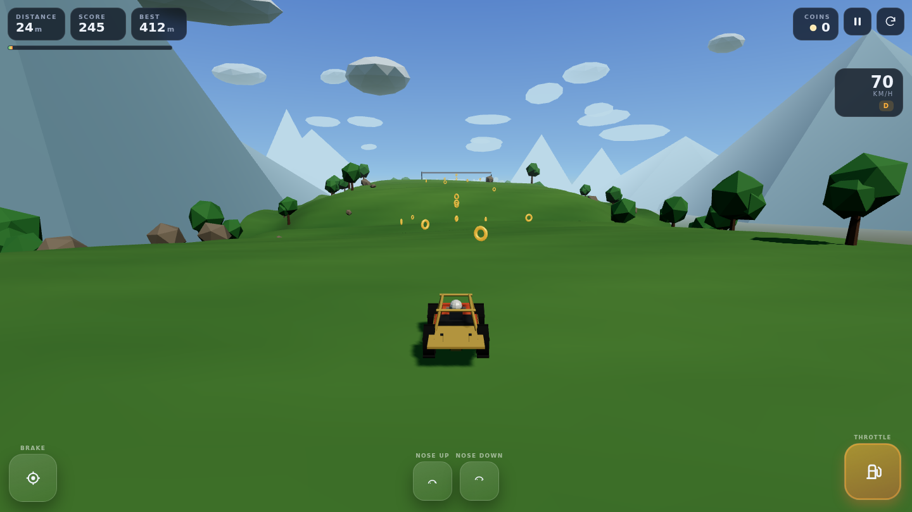

# Ridgeline Rally

An original 3D hill-driving game for the browser. Balance a rig over procedural
ridgelines, clear crests, collect coins, buy new vehicles and unlock five
hand-built worlds. Runs on desktop, laptop, tablet and phone — no installs, no
accounts, no backend.



---

## Contents

- [Feature list](#feature-list)
- [Tech stack](#tech-stack)
- [Quick start](#quick-start)
- [Commands](#commands)
- [Deployment](#deployment)
- [Controls](#controls)
- [Architecture](#architecture)
- [Tuning the game](#tuning-the-game)
- [Progression and saves](#progression-and-saves)
- [Performance notes](#performance-notes)
- [Project layout](#project-layout)

---

## Feature list

**Driving**
- Real rigid-body vehicle simulation (Rapier ray-cast vehicle controller): four
  independently sprung wheels, per-wheel suspension, tyre friction, weight transfer.
- Airborne pitch control, natural jumps, landing impacts, crash and flip
  detection, checkpoint respawns.
- Five rigs with genuinely different handling (a light buggy, a monster truck, a
  rally coupe, a long-wheelbase pickup and an expedition SUV). Each has its own
  mass, wheelbase, suspension, engine force, grip and top speed.

**Worlds**
- Five procedurally generated environments: Green Highlands, Granite Ridges,
  Sunscorch Dunes, Frostpeak Pass, Ember Caldera.
- Each world has its own palette, sky gradient, fog, scenery (broadleaf trees,
  pines, cacti, dead trees, snow caps), clouds and grip multiplier — ice and sand
  really do break traction.
- Terrain is generated from layered noise plus hand-placed launch ramps, then
  passed through a crest smoother and a gradient limiter so every difficulty
  stays drivable rather than containing unclimbable walls.

**Gameplay**
- Three difficulties that change track length, hill amplitude, corridor width,
  ramp height, obstacle density, grip and rewards — not just a label.
- Distance, speed, score, coins, best distance per world, checkpoints with
  limited respawns, stage completion bonus.
- Coin trails and coin arcs over jumps; obstacles that are real physics bodies.

**Interface**
- Main menu with difficulty, world and garage selection, unlock costs and records.
- Full garage screen with stat bars and vehicle previews.
- In-game HUD: distance, score, best, coins, speedometer, gear/air indicator,
  progress bar, pause and restart.
- Result screen (crash reasons, best distance, retry / continue / menu) and a
  pause screen with settings.
- Unified press-and-hold controls: on-screen pedals work with mouse and
  multi-touch, and can be mixed with the keyboard at the same time.

**Audio**
- 100% procedural WebAudio — engine note that follows RPM and throttle, landing
  thumps, coin chimes, checkpoint/finish stingers, UI clicks and an ambient bed.
  Separate effects/music volumes, mute, and the game is fully playable muted.

**Technical**
- TypeScript throughout, modular systems, fixed-timestep physics with a
  frame-rate-independent render loop.
- Adaptive pixel ratio, quality toggle, automatic resolution drop if the frame
  rate falls, simulation paused when the tab is hidden.
- localStorage save of coins, unlocks, selections, settings and statistics.
- Configurable base path for hosting under a sub-directory, SPA fallback config
  for Vercel / Netlify / Cloudflare Pages.

---

## Tech stack

| Layer | Choice | Why |
| --- | --- | --- |
| Rendering | **Three.js** | Small, stable, well documented; direct control over draw calls |
| UI | **React 18 + TypeScript** | Menus and overlays are plain DOM, so React is perfect and never touches the render loop |
| Physics | **Rapier 3D (compat build)** | Deterministic Wasm rigid bodies with a battle-tested ray-cast vehicle controller |
| Build | **Vite 5** | Instant dev server, small production bundles, easy static deployment |

No game framework, no asset pipeline, no CDN. All meshes, materials, textures and
sounds are generated at runtime.

---

## Quick start

Requires **Node.js 18+**.

```bash
npm install       # install dependencies
npm run dev       # start the dev server on http://localhost:5173
```

Open the printed URL and press **Drive**. That's it.

---

## Commands

| Command | Description |
| --- | --- |
| `npm run dev` | Vite dev server with hot reload |
| `npm run build` | Type-check with `tsc` and build to `dist/` |
| `npm run preview` | Serve the production build locally |
| `npm run typecheck` | Types only, no build |
| `npm run sim` | Headless physics harness — drives the real terrain and vehicle code in Node and prints distance/speed/air-time telemetry (handy for handling tuning) |

### Deploying under a sub-path

```bash
BASE_PATH=/games/ridgeline/ npm run build
```

`vite.config.ts` reads `BASE_PATH` (default `/`) and Vite rewrites asset URLs,
including the `favicon` in `index.html`. Works for GitHub Pages project sites,
S3 prefixes, etc.

---

## Deployment

The build output is a completely static site in `dist/`. Nothing else is needed.

**Netlify** — connect the repo; `netlify.toml` already sets
`command = "npm run build"`, `publish = "dist"` and the SPA redirect.

**Vercel** — import the repo; `vercel.json` sets the build command, output
directory and the rewrite.

**Cloudflare Pages** — build command `npm run build`, output directory `dist`.
`public/_redirects` is copied into the build for the SPA fallback.

**Any static host / Apache / Nginx** — upload the *contents* of `dist/`. The game
is a single page; configure a fallback so unknown paths return `index.html`:

```nginx
location / {
  try_files $uri $uri/ /index.html;
}
```

Note that the SPA fallback matters only if you deep-link; the game itself uses no
client-side routes, so plain static hosting also works out of the box.

**No backend, no API keys, no paid services.** Rapier's Wasm is bundled inline by
Vite, so there are no cross-origin or MIME issues with `.wasm` files.

---

## Controls

### Keyboard

| Key | Action |
| --- | --- |
| `W` / `↑` | Accelerate |
| `S` / `↓` | Brake, then reverse |
| `A` / `←` | Steer left — also pitches the nose **up** in the air |
| `D` / `→` | Steer right — also pitches the nose **down** in the air |
| `Space` / `Shift` | Handbrake |
| `R` | Restart stage |
| `Esc` / `P` | Pause / resume |

### Mouse

Click and **hold** the on-screen Throttle, Brake and Nose Up/Down pads. They are
real press-and-hold controls (Pointer Events with pointer capture), so they
behave exactly like touching a pedal. Pause and restart are in the HUD.

### Touch

Landscape is recommended. Throttle sits under the right thumb, brake under the
left, and the two air-balance pads sit in the middle. Multi-touch is supported,
so you can hold throttle and steer/balance at the same time. Page scrolling,
double-tap zoom and long-press menus are suppressed while playing.

All three input sources feed one unified `ControlState`, so keyboard and
touch can be used together.

---

## Architecture

```
GameEngine  (owns the loop, one run per instance)
├── SceneSetup          renderer, camera, gradient sky, sun + shadows
├── CameraController    chase camera: heading follow, speed pull-back, shake
├── PhysicsWorld        Rapier world wrapper (trimesh terrain, static bodies)
├── TerrainGenerator    heightfield + mesh + analytic sampler + gradient limiter
├── VehiclePhysics      rapier ray-cast vehicle: engine, brakes, steering, air control
├── VehicleView         procedural low-poly vehicle meshes, wheel/suspension visuals
├── InputManager        keyboard + pointer → single ControlState
├── CoinSystem          instanced coin field, pickups
├── ScenerySystem       trees, rocks, mountains, clouds, checkpoint gates, collision
├── ScoreSystem         distance, coins, checkpoints, score multipliers
└── AudioManager        procedural WebAudio engine + effects
```

Supporting modules: `config.ts` (all tuning values), `difficulties.ts`,
`environments.ts`, `vehicles.ts` (data tables), `save/SaveManager.ts`
(localStorage progression), plus `src/ui/*` for the React menus, HUD, overlays and
touch controls.

Design rules used throughout:

- **Data driven.** Adding a world or a vehicle is a new entry in a table — no
  engine changes.
- **Headless-testable physics.** `VehiclePhysics` and `TerrainGenerator` have no
  DOM or rendering dependencies, which is what `npm run sim` exercises.
- **One fixed timestep.** Physics runs at 60 Hz with up to 6 sub-steps per frame;
  rendering interpolates nothing but smooths visuals with frame-rate independent
  damping, so slow devices stay in real-time instead of going into slow motion.
- **React is not in the loop.** The HUD receives a snapshot 10× a second; the
  renderer and physics never touch React state.

---

## Tuning the game

Everything worth tweaking lives in four files:

| File | Contains |
| --- | --- |
| `src/game/config.ts` | Gravity, timestep, camera feel, brake/handbrake force, air pitch rate, crash windows, coin spacing, score values |
| `src/game/difficulties.ts` | Track length, hill amplitude/frequency/roughness, ramp count and height, corridor width, cliff drop, max gradient, grip and engine scaling, rewards, checkpoints |
| `src/game/vehicles.ts` | Per-rig chassis size, wheel radius/travel/stiffness, mass, engine force, max speed, grip, colours and body style |
| `src/game/environments.ts` | Palettes, fog, sun/ambient intensity, grip, snow/ash caps, scenery density |

Quick recipe for a new vehicle: copy an entry in `vehicles.ts`, give it an id in
`types.ts` (`VehicleId`), add it to `VEHICLE_ORDER`, and (optionally) pick one of
the existing `style` body builders or add a `case` in
`src/game/vehicle/VehicleView.ts`.

Quick recipe for a new world: copy an entry in `environments.ts`, add the id to
`EnvironmentId` and `ENVIRONMENT_ORDER`. Terrain, scenery and coins are generated
from the config automatically.

---

## Progression and saves

Stored under the key `ridgeline-rally.save.v1` in `localStorage`:

- total coins, best distance overall and per world
- unlocked vehicles and worlds, current selection
- selected difficulty
- settings (effects volume, music volume, mute, quality, touch-control visibility)
- statistics (runs, total distance, total coins)

Coins earned in a run are banked when the run ends (crash, finish, restart or
leave-to-menu), so nothing is lost. Corrupt or unavailable storage is handled
gracefully — the game runs with defaults. "Reset progress" is in Settings.

---

## Performance notes

- Pixel ratio is capped at 2 and adapts down to 0.8 if the average frame rate
  drops below ~45 fps (and back up when there is headroom).
- Terrain is one trimesh mesh with vertex colours plus one small tiled noise
  texture — a single draw call. Trees, rocks, mountains and clouds are
  `InstancedMesh` batches; coins are one instanced draw.
- Shadows use a single directional light with a tight frustum that follows the
  car, so the whole world never needs shadow-casting.
- Physics: one vehicle rigid body, a fixed trimesh, and a handful of static
  obstacle balls — a very small island for the solver.
- Everything is disposed on unload (geometries, materials, renderer, physics
  world), and the React component tears the engine down on unmount.
- The tab being hidden pauses the simulation; the audio context is suspended.
- Rapier is lazy-loaded, so the menu loads instantly and the physics engine
  arrives only when a run starts.

---

## Project layout

```
ridgeline-rally/
├── index.html
├── package.json
├── tsconfig.json
├── vite.config.ts          base path, manual chunks, dev/preview host config
├── vercel.json
├── netlify.toml
├── public/
│   ├── _redirects          SPA fallback for Cloudflare Pages / Netlify
│   └── favicon.svg
├── tools/
│   ├── headless-sim.ts     physics telemetry harness
│   ├── slopes.ts           terrain gradient report
│   ├── steep-probe.ts      long-steep-climb telemetry
│   └── run-sim.mjs         bundles + runs the harness (npm run sim)
└── src/
    ├── main.tsx
    ├── App.tsx             screen state, overlays, engine lifecycle
    ├── index.css           design tokens, menu, HUD, touch controls
    ├── game/
    │   ├── GameEngine.ts
    │   ├── config.ts
    │   ├── types.ts
    │   ├── difficulties.ts
    │   ├── environments.ts
    │   ├── vehicles.ts
    │   ├── camera/CameraController.ts
    │   ├── scene/SceneSetup.ts
    │   ├── physics/PhysicsWorld.ts
    │   ├── terrain/TerrainGenerator.ts
    │   ├── vehicle/VehiclePhysics.ts
    │   ├── vehicle/VehicleView.ts
    │   ├── input/InputManager.ts
    │   ├── gameplay/CoinSystem.ts
    │   ├── gameplay/ScenerySystem.ts
    │   ├── gameplay/ScoreSystem.ts
    │   ├── audio/AudioManager.ts
    │   └── save/SaveManager.ts
    └── ui/
        ├── MainMenu.tsx
        ├── Garage.tsx
        ├── GameView.tsx
        ├── HUD.tsx
        ├── TouchControls.tsx
        ├── Overlays.tsx
        ├── SettingsPanel.tsx
        ├── Icons.tsx
        └── ui.css
```

---

## Credits

Design, code, procedural art and procedural audio made for this project. No
third-party art or audio assets are included, and nothing is derived from other
games — the hill-climb genre is the only shared idea.

Licensed under the MIT License (see `LICENSE`).
